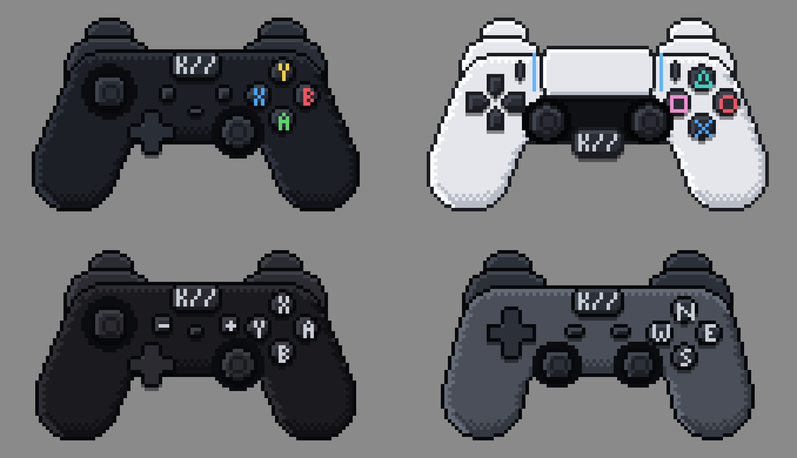

# padmap

**Which controller is this, what are its buttons called, and how do you remap it?**

A small, dependency-free Rust crate that answers the questions every game launcher, emulator front-end and input remapper ends up answering again. It does not read controllers itself: pair it with whatever does ([gilrs](https://gitlab.com/gilrs-project/gilrs), SDL, evdev, the browser's Gamepad API).

Made for [Kryoto Desktop](https://kryo.to), MIT licensed.



## What it does

| | |
|---|---|
| `identify(vendor, product, name)` | Tells a pad's **family** (Xbox, PlayStation, Nintendo, or generic) and **model** (DualSense Edge, Xbox Elite Series 2, Switch Pro Controller, Steam Deck…) from its USB ids. When there are none, as with XInput, it falls back to the pad's name, then to its maker. It also reports how it knew. |
| `Layout(family).label(control)` | What each control is **called** on that pad: `A` / `Cross` / `B` for the bottom button, `RT` / `R2` / `ZR`, `View` / `Create` / `-`. Also which button **confirms** in menus (A on the right on Nintendo pads). |
| `Remap` | "This button acts as that one", always kept a **valid permutation**: giving a button a new job hands its old job to the button that had it. No job is ever lost or doubled. |
| `SdlMapping` | Parses an SDL game controller mapping and **rewrites it under a `Remap`**. The result goes in `SDL_GAMECONTROLLERCONFIG`, which SDL games read, and so do Wine and Proton, whose controller driver is built on SDL. Steam passes its remaps to games on Linux the same way. |
| `lookup(guid)` (feature `sdl-db`) | Finds the mapping for a Linux pad's SDL GUID in the bundled [SDL_GameControllerDB](https://github.com/mdqinc/SDL_GameControllerDB) (zlib licence). It matches the way SDL does: exactly, then ignoring the name CRC, then ignoring the version. |

Controls are named **by where they are, not by what is printed on them**: `Control::South` is the bottom face button on every pad. SDL names them the same way (its `a`), and it is the only naming under which "swap A and B" means the same thing on every controller.

## Example

```rust
use padmap::{identify, Control, Family, Layout, Remap, SdlMapping};

// A DualSense over Bluetooth calls itself "Wireless Controller".
let pad = identify(Some(0x054c), Some(0x0ce6), "Wireless Controller");
assert_eq!(pad.family, Family::PlayStation);
assert_eq!(pad.name, "DualSense");
assert_eq!(Layout(pad.family).label(Control::South).short, "Cross");

// Swap the bottom and right buttons, for games.
let mut remap = Remap::new();
remap.assign(Control::South, Control::East);

let base = padmap::lookup("030000004c050000e60c000011810000").unwrap(); // feature "sdl-db"
let line = base.remapped(&remap).to_line();
std::env::set_var("SDL_GAMECONTROLLERCONFIG", padmap::config_env([line.as_str()]));
```

For an SDL remap to reach a game, SDL has to see the pad through the same driver the mapping was written for. On Linux, also set `SDL_JOYSTICK_HIDAPI=0` (SDL's HIDAPI drivers address PlayStation and Switch pads by another GUID) and, for Proton, `PROTON_PREFER_SDL=1`.

## Features

- `serde`: `Serialize` / `Deserialize` for the public types. A `Remap` stores as `{"a":"b","b":"a"}`.
- `sdl-db`: the Linux half of SDL_GameControllerDB (about 200 KB) and `lookup`.

## The drawings

`art/` holds each family as a pixel-art SVG, 112 × 64 art pixels, each in its own colours: a carbon Xbox pad, a white and black DualSense with its light bars, a black Switch Pro, a grey universal pad. Light comes from the top left, the grips fade into a dithered shade, and every key casts a one-pixel shadow. Every control is its own `<g id="…">` named by its SDL name (`a`, `leftshoulder`, `dpup`…), so a page can light up what is pressed. Kryoto Desktop draws them live from `src/lib/pad-art.ts` in kryoto-desktop. The home button wears Kryoto's K// mark.

## Refreshing the database

```sh
scripts/update-sdl-db.sh
```

It downloads the newest `gamecontrollerdb.txt` and keeps its Linux lines.

## Licence

MIT, see [LICENSE](LICENSE). `data/gamecontrollerdb-linux.txt` is from SDL_GameControllerDB, under the zlib licence ([data/LICENSE-SDL_GameControllerDB](data/LICENSE-SDL_GameControllerDB)).
